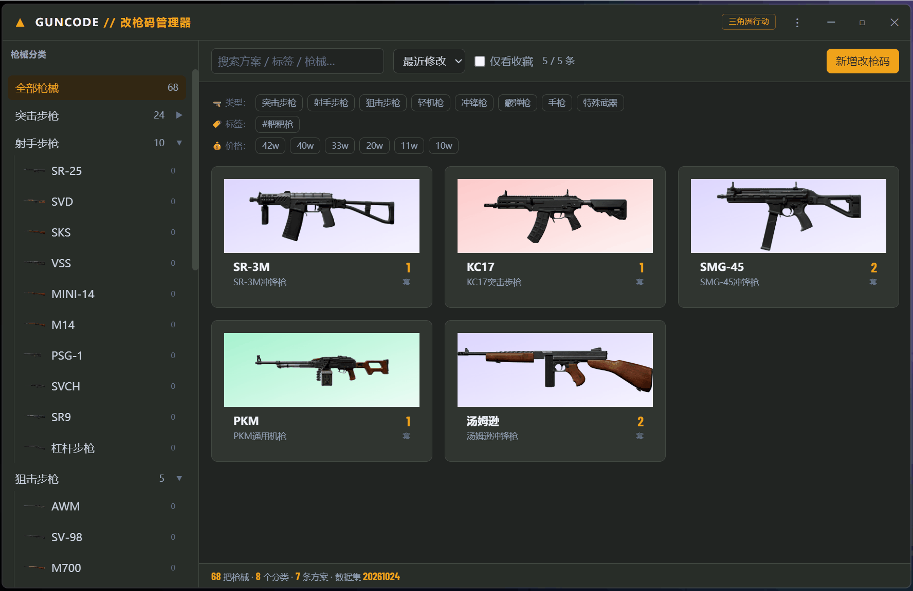
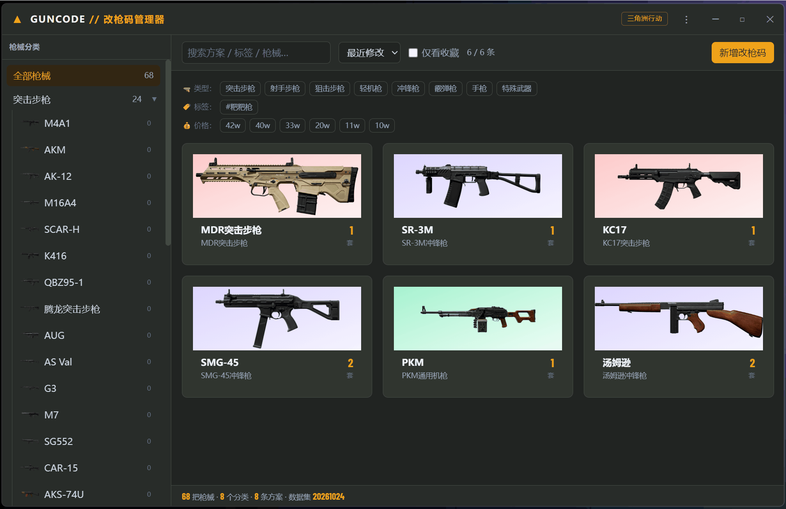
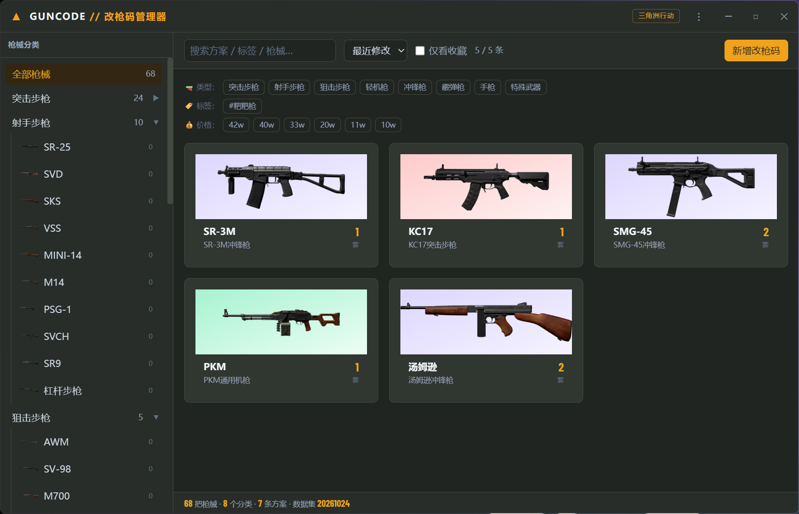
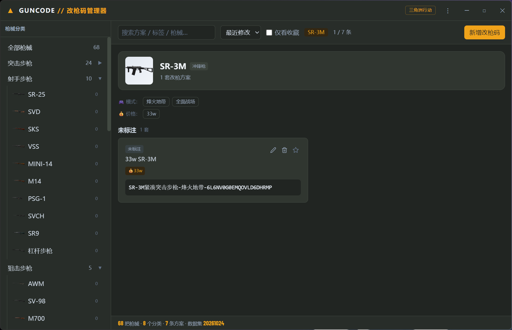
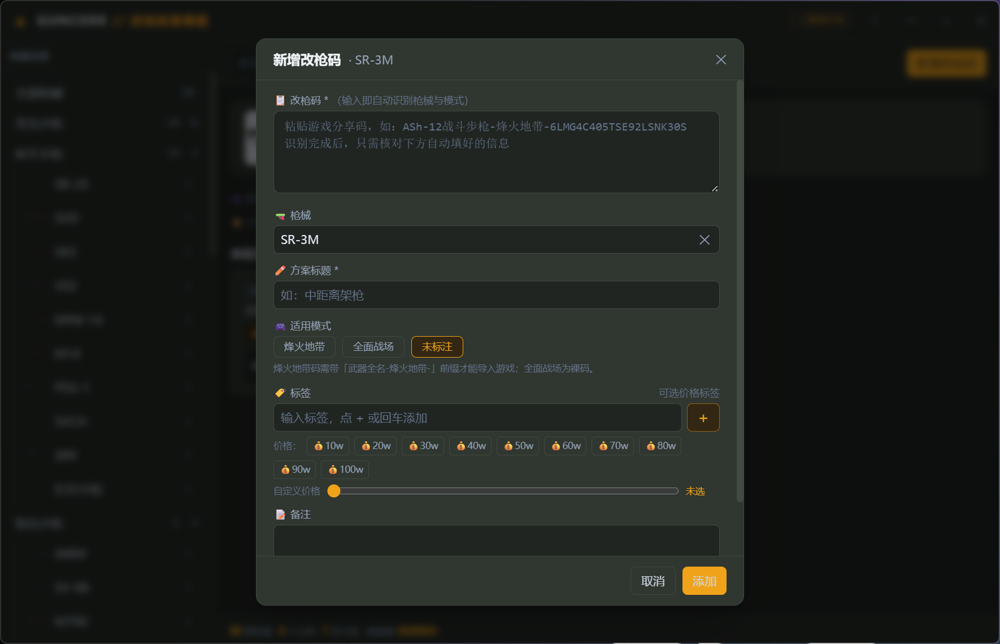
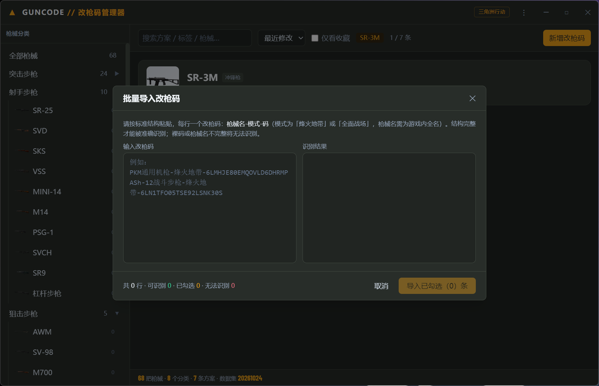

# GunCode 改枪码管理器

《三角洲行动》(Delta Force) 个人改枪码 / 配枪方案的本地管理器。卡片式浏览、一键复制、离线可用。

> 当前版本 **1.3.0**（S0–S7 全部完成，处于 1.x 连续迭代）。功能进度见 [PROGRESS.md](PROGRESS.md)。

## 功能

- **枪械库**：内置三角洲行动 8 大分类 / 68 把枪械（离线数据集，含官方武器图，可自建补充）
- **卡片浏览**：按分类 / 枪械筛选，卡片式展示该枪械下的所有改枪方案；点击卡片即复制；卡片底部展示导入 / 更新时间
- **一键复制**：点击卡片即可复制，按模式自动补前缀，直接粘进游戏「仓库 → 改装 → 方案导入」
- **输入即识别**：新增改枪码时输入 / 粘贴自动识别枪械与模式（枪名后允许带价格标签如「40w」、备注如「满改」，标题直接用码内原文，含连字符枪名如「ASh-12」完整保留）；带「自动识别」开关，可关闭后手动填写；实时预览「导入游戏时将复制的完整串」
- **批量导入**：大输入框逐行粘贴多行改枪码，逐行校验（可识别 / 裸码待配置 / 无法识别）；支持**纯裸码**导入（识别为「待配置」，展开选择枪械与模式）；每条可配置标题 / 价格 / 标签；左侧修改自动重新识别
- **方案管理**：新增 / 编辑 / 删除、标签、价格标签、备注、收藏置顶
- **搜索排序**：按标题 / 标签 / 备注 / 枪械名模糊搜索；按时间 / 收藏 / 标题 / **价格**排序
- **检查更新**：关于弹窗内一键查询 GitHub 最新 Release 并提示是否有新版本
- **快捷键**：`Ctrl+F` 聚焦搜索、`Ctrl+N` 新建、`Ctrl+Q` 退出、`Esc` 关闭弹窗
- **备份迁移**：一键导出 / 导入 JSON

## 功能演示

**主界面浏览与使用**



**新增改枪码**（输入即识别 + 价格滑块/预设）


**批量导入改枪码**（逐行识别校验 + 勾选导入）



## 界面一览









## 技术栈

| 层 | 选型 |
|---|---|
| 桌面框架 | Wails v2.9.2（Go + WebView2） |
| 后端 | Go 1.23 |
| 前端 | Vue 3 + TypeScript + Vite |
| 样式 | Tailwind CSS **v3**（暖军绿灰 + 琥珀橙主题） |
| 数据库 | SQLite via GORM + `github.com/glebarez/sqlite`（纯 Go，免 CGO） |

## 快速开始

```powershell
# 开发模式（热重载）
wails dev

# 构建可执行文件 → build/bin/GUNCODE.exe
wails build

# 构建 + 生成 NSIS 安装包 → build/bin/GUNCODE-amd64-installer.exe
# （注意：makensis 不在 PATH，需先把 NSIS 目录加入 PATH）
$env:Path = 'C:\Program Files (x86)\NSIS;' + $env:Path
wails build --nsis

# 前端单独构建 / 类型检查
npm --prefix frontend run build

# 检查本地数据库内容（分类 / 枪械 / 方案数量与完整性）
go run ./cmd/dbcheck
```

数据库文件位于 `%APPDATA%\GunCode\guncode.db`（`os.UserConfigDir()`），首次启动自动建库并写入枪械数据集。

## 目录结构

```
guncode/
├─ main.go                    # Wails 入口（无边框自绘标题栏）
├─ app.go                     # 对外暴露的方法（Go ⇄ 前端桥）
├─ internal/
│  ├─ model/                  # GORM 实体与 DTO
│  ├─ store/                  # DB 初始化 + 仓储层
│  ├─ seed/
│  │  ├─ data/weapons.json    # ★ 枪械分类与基础信息数据集（唯一数据源）
│  │  └─ seed_weapons.go      # 首次启动写入数据库
│  └─ service/                # 业务逻辑（改枪码解析 / 拼装）
├─ frontend/src/
│  ├─ components/             # WeaponSidebar / FilterBar / LoadoutCard / CodeModal / ImportTextModal …
│  ├─ composables/            # useGunCode / useToast / useClipboard
│  ├─ views/                  # HomeView
│  ├─ public/weapons/         # 武器图（官方 playerhub 图，{key}.png）
│  ├─ types/                  # 与 Go 结构体对应的 TS 类型
│  └─ api/                    # window.go.main.App.* 的薄封装
├─ build/windows/             # 窗口图标 / NSIS 安装脚本
├─ cmd/dbcheck/               # 数据库检查小工具
└─ PROGRESS.md                # 阶段进度与版本迭代记录
```

## 枪械数据集说明

`internal/seed/data/weapons.json` 是本项目**枪械信息的唯一数据源**（8 分类 / 68 把枪，与官方武器总数对齐）。

### 字段

| 字段 | 含义 |
|---|---|
| `id` | 稳定英文标识（`m4a1`、`yeniu` …），用于前端 key 与关联 |
| `name` | 型号简称，界面主要展示 |
| `inGameName` | **游戏内武器全名**（含品类后缀），拼接烽火地带分享码前缀时使用 |
| `category` | 分类 id：`ar` / `dmr` / `sniper` / `lmg` / `smg` / `shotgun` / `pistol` / `special` |
| `aliases` | 别名，搜索时一并匹配 |
| `caliber` | 口径 / 弹药，未核实为 `null` |
| `status` | `available` 确认存在 / `unverified` 待核实 / `removed` 疑似下架 |
| `source` | `official` 官方 / `db` 第三方站 / `user` 用户自建 |
| `note` | 备注 |

分类计数：`ar 24 / dmr 10 / smg 12 / shotgun 5 / lmg 4 / sniper 5 / pistol 7 / special 1`。

### 为什么必须有 `inGameName`

三角洲的分享码分两种模式，**互不通用**：

| 模式 | 格式 | 示例 |
|---|---|---|
| 烽火地带 | `{武器全名}-烽火地带-{码主体}` | `AKM突击步枪-烽火地带-6KJ5IFS0A021USGQ8AC2S` |
| 全面战场 | `{码主体}`（裸码） | `6EIAL2G02U9HU6AC38CQJ` |

烽火地带的前缀**缺一不可**，否则游戏内导入失败。而全名的品类后缀存在特例，**不能用类别名拼**：

- `M7战斗步枪`（不是「M7突击步枪」）
- `G3战斗步枪`、`SCAR-H战斗步枪`（战斗步枪，属步枪大类）
- `R93狙击步枪`、`AKM突击步枪`、`S12K霰弹枪`
- `野牛冲锋枪`、`勇士冲锋枪`、`腾龙突击步枪`（官方中文名）

### 数据来源与核对记录

| 来源 | 用途 | 可信度 |
|---|---|---|
| 腾讯官方《三角洲行动》公告与官方武器全表（`dfttk /data/v3/locales/zh-CN/items.json`） | 武器 id→中文名全表、分类、官方图（playerhub） | 高 |
| 第三方图鉴站 `dfttk.com/firefight/library`、`deltaforcetools.gg` | 图例、分类交叉验证 | 中 |
| 游戏内【军械库 / 武器手册】 | 最终事实来源 | 最高（个别冲突以游戏实际为准） |

**核对结论（2026-10-24）**：
- **删除 3 把臆造枪**（官方表无、游戏里没有）：`K15`、`UMP45`、`AK24`
- **补录 4 把真枪**：`MCX-LT` / `RM277` / `MDR突击步枪`（突击步枪）、`SR9`（射手步枪）
- 数据集 **68 把 = 官方武器总数**，分类完全对齐
- 武器图 **68 张 = 全部 68 把枪**（官方 playerhub 图，存于 `frontend/public/weapons/`）
- 更正全名：`PKM→PKM通用机枪`、`M250→M250通用机枪`、`QJB-201→QJB201轻机枪`、`G3→G3战斗步枪`、`SCAR-H→SCAR-H战斗步枪`
- 确认：`SR-3M` 冲锋枪、`腾龙突击步枪`（国服名，台服「191式」）；特殊武器 = 复合弓 + 杠杆步枪（杠杆步枪归射手步枪 dmr）

**数据版本**：`meta.datasetVersion = 20261024`。三角洲随赛季增删武器，赛季更新后请核对游戏内军械库，更新 `datasetVersion` 与各条 `status`。

---

## 免责声明

本软件为 **《三角洲行动》玩家自制的免费工具**，无盈利性质，非官方产品，与腾讯 / 琳琅天上无任何关联。软件内使用的武器名称、图片、游戏素材等版权均归原权利方所有，仅供个人学习与整理参考。请以游戏内实际内容为准；如涉版权异议请联系作者处理。
